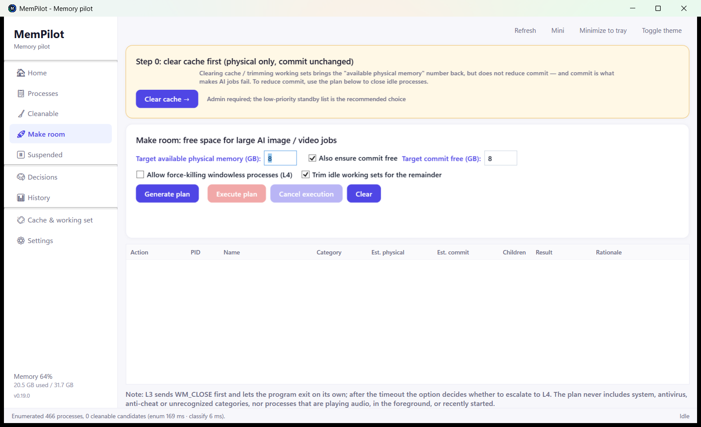
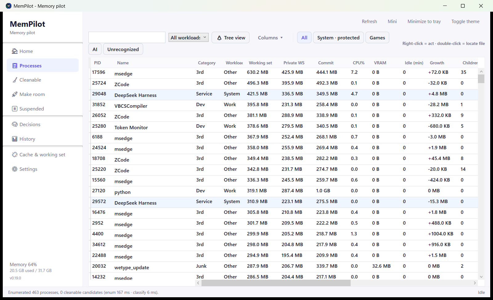

# MemPilot

<p align="center">
  <a href="#download"></a>
  <a href="LICENSE"></a>
  <a href="https://github.com/ShuiQiongChuYunQiShi/MemPilot/actions/workflows/ci.yml"></a>
</p>

**Process-level memory scheduling for Windows — built for machines that run
AI image/video generation, games, and development at the same time.**

MemPilot does not "clean your RAM". It identifies what each process actually
is, decides what is genuinely unused, and moves or releases memory **per
process** — so your ComfyUI job gets the memory it needs without your
browser tabs, IDE, or game becoming collateral damage.

<p align="center">
  
</p>

> 🇨🇳 中文说明：见 [docs/README-zh.md](docs/README-zh.md)。

## Download

| Channel | File | Size | Needs |
|---|---|---|---|
| **Portable (recommended)** | `MemPilot-<ver>-portable.zip` | **~500 KB zip / ~440 KB extracted** | [.NET 10 Desktop Runtime](https://dotnet.microsoft.com/download/dotnet/10.0) |
| Self-contained | `MemPilot-<ver>-win-x64.exe` | ~62 MB | nothing — runtime is bundled |

Both are on the [Releases page](https://github.com/ShuiQiongChuYunQiShi/MemPilot/releases/latest).
Every release ships a `SHA256SUMS.txt`; verify before running:

```powershell
(Get-FileHash .\MemPilot-<ver>-win-x64.exe -Algorithm SHA256).Hash.ToLower()
Get-Content .\SHA256SUMS.txt
# the two values must match
```

Releases are **unsigned** — SmartScreen or your antivirus may warn on first run.
That is expected for a new project, not a sign the file is broken. See
[SECURITY.md](SECURITY.md) for the trust model and [docs/PRIVACY.md](docs/PRIVACY.md)
for what data is stored (and what never leaves your machine).

## Try it in 60 seconds

The lease API is the part no other memory tool has: a task asks for memory before
loading a model, gets **the amount actually freed** back, and returns it afterwards.

```powershell
# 1. install (pick one)
#    a) winget — manifest is in this repo, submission in review; usable from the next release
winget install ShuiQiongChuYunQiShi.MemPilot
#    b) today — download MemPilot-<ver>-win-x64.exe from Releases (no runtime needed)

# 2. turn the lease API on once: Settings -> 租约 API  (default port 52717)
#    the bearer token is written to %APPDATA%\MemPilot\lease-token.txt

# 3. run the self-check — it reads the token and port for you
python tools/lease-demo.py --gb 4 --policy hard --stress
```

Expected shape (every line is a claim this project has to keep):

```
租约 c31c54f71963（hard）· 实测 14.98 GB / 目标 16.0 GB · 缺口 1.02 GB
  ✓ 调用方自身（pid=34152）不在处置范围 · 挂起 3 个
  ✓ 归还状态 released · 恢复 3/3 个挂起进程
```

- `实测 … 缺口 …` — it reports what it actually freed, not what you asked for.
- `调用方自身…不在处置范围` — the caller and its process tree are never suspended
  (`requesterPid`), so an agent cannot freeze its own worker.
- `恢复 3/3` — every suspended process came back, and the count comes from the
  response, not from a log you have to trust.

## Use it from an agent (MCP)

MemPilot ships a minimal MCP server over stdio, so an agent can check and reserve memory
without anyone writing HTTP by hand. Add it to your MCP client:

```json
{
  "mcpServers": {
    "mempilot": {
      "command": "C:\\Program Files\\MemPilot\\MemPilot.exe",
      "args": ["--mcp"]
    }
  }
}
```

Replace the path with wherever `MemPilot.exe` lives. A winget portable install also puts
`mempilot` on PATH, so `"command": "mempilot"` works there too.

Three tools, deliberately — every extra tool is another way for a model to pick wrong:

| Tool | What it does |
|---|---|
| `mem_status` | memory state, `capabilities` (`lease`, `lease.plan`), and `limits` |
| `mem_plan` | zero-action preview: measured current memory, an upper-bound projection, which processes *would* be suspended, and how many the safety rules exclude (and why) |
| `mem_lease` | acquire (returns the amount **actually** freed) / release |

The server is a **client only**: it forwards to the lease API on 127.0.0.1. The lease
ledger has to stay in the single long-running process that can actually restore what it
suspended — a second process with its own ledger is how you get processes suspended with
nobody to resume them. If MemPilot isn't running or the lease API is off, the tools return
an error saying exactly what to turn on.

`mem_lease` also takes `waitSeconds` (0–120): if another lease is active, it retries with
the server-suggested backoff (`retryAfterSeconds`, capped at 10s) until the slot frees up
or the wait expires, and reports the current holder either way. The retry lives in the MCP
client, not the server — a long-polled request would leave leases granted to clients that
already timed out.

`mem_plan` takes no action at all: it reads the last process snapshot and returns a
projection. `projectionBasis` tells you how to read that number — `hard-upper-bound`
(current + private bytes of processes that would be suspended) or `current-only`
(a lower bound; soft reclaim can't be predicted).

Optional skill files, so an agent knows **when** to use it rather than just that it exists:

```powershell
# Claude Code: install the skill
Copy-Item -Recurse skills\mempilot $env:USERPROFILE\.claude\skills\mempilot
# Codex / ZCode: paste the snippet into your project's AGENTS.md
Get-Content docs\agents\mempilot-agents-snippet.md
```

### Or just wrap the command

If the job is a plain command line — which is how agents usually start one — wrap it:

```powershell
mempilot lease run --gb 16 -- python gen.py
```

It plans, acquires, runs the child, and releases when the child exits (including failure and
Ctrl+C). `--policy hard` also suspends idle background processes, `--dry-run` prints the plan
without acquiring, `--wait 60` queues behind another lease.

(`mempilot` is on PATH once installed with winget; before that, call `MemPilot.exe` directly.)

## Two problems, not one

Most memory utilities treat RAM as one number and flush it. Measured on a real
machine over 9 days (1,392 samples):

```
Physical RAM        31.7 GB
Commit limit        44.7 GB  (pagefile 13 GB in use)
Committed (median)  30.1 GB  = 95% of physical
Committed (peak)    68.3 GB
Commit ≥ 90%        11.2% of all samples
Physical < 4 GB     only 3.2% of samples
```

**The real bottleneck on a working machine is commit, not physical memory.**
A standby-list purge does nothing about commit — which is why tools that only
show "freed 2 GB" rarely make your next AI generation any less likely to fail.

So MemPilot does both, and keeps them apart:

| You want | Action | What it actually changes |
|---|---|---|
| The "available" number back | Purge standby lists, flush file/registry cache, trim working sets | Physical occupancy only — **commit does not move** |
| The next AI job not to fail | Gracefully close idle background processes | Commit drops by their private bytes |

Both live in the UI. The cache tools are on the 「清缓存与工作集」 page: admin
required, explicit item selection, with a risk warning. The commit-relieving
action asks for confirmation per candidate and is written to the audit log.
Every result says which of the two it changed — "released 2 GB, commit
unchanged" is a valid and honest outcome, and it is never sold as an OOM fix.

## What it does

### 1. Classifies before it acts

Every process gets an identity before it can become a candidate:
exact-name rules, path fragments, **verified publisher signatures**
(WinVerifyTrust — a self-signed cert claiming "Microsoft" does not pass),
Steam library parsing, registry uninstall evidence, and service/startup/
scheduled-task membership. Unrecognized (`Unknown`) processes are **never
actioned automatically**.

### 2. Detects "unused" honestly

A candidate needs all of: minimum age (default 120 s), N consecutive idle
observations, no visible window, low CPU and I/O, **and no audio activity**
(WASAPI session peak detection — a process playing music in the background is
not unused). Idle state is tracked per `(pid, startTime)`, so PID reuse cannot
poison the observation.

### 3. Escalates in steps, never jumps

| Level | Action | Automatic? |
|---|---|---|
| L1 | Trim working set (`EmptyWorkingSet`) | yes (opt-in) |
| L2 | Suspend process (`NtSuspendProcess`, atomic, restorable) | yes (opt-in, hard lease only) |
| L3 | Graceful close (`WM_CLOSE` → wait → optional escalate) | only with confirmation |
| L4 | Force kill | **never automatic** — manual, double-confirm |

### 4. Explains itself

Every automatic decision — why a mode switched, who was executed or skipped
and exactly which guard skipped them — is persisted to `decisions.json`
(5,000 entries, important kinds like `Lease`/`AiSession` get a protected
quota so noise cannot evict them). There is a UI page for it. If the tool
cannot get admin rights, the log says **"skipped: needs admin"**, not
"executed, freed 0 MB".

### 5. The Lease API — ask for memory like you ask for a lock

This is the part none of the classic memory cleaners have. An AI task that
knows it needs 12 GB can ask before loading its model, and give it back after:

```python
status, lease = post("/api/lease", {
    "targetAvailableGb": 12,
    "ttlSeconds": 3600,
    "requester": "comfyui-job-42",
    "policy": "soft",          # or "hard": also suspends sufficiently-idle processes
})
# lease["achievedAvailableGb"] — what was ACTUALLY freed, measured, not promised
try:
    run_generation()
finally:
    delete(f"/api/lease/{lease['id']}")   # suspended processes are restored automatically
```

- Binds `127.0.0.1` only, Bearer-token authenticated, **disabled by default**
- Single active lease; TTL clamped 30 s–24 h; breach of the granted floor raises an alert
- `hard` policy suspends at most 8 "idle enough" processes and **restores every one** on release
- Working / gaming / foreground / audio / protected processes are never touched by either policy
- Full reference: [docs/LEASE-API.md](docs/LEASE-API.md) · working example: [`tools/lease-example.py`](tools/lease-example.py) ·
  load simulation that asserts the whole chain: [`tools/lease-load-test.py`](tools/lease-load-test.py)
- Notification behaviour (what pings you and how often): [docs/NOTIFICATION-POLICY.md](docs/NOTIFICATION-POLICY.md)

### 6. Suggests action for junk you never used

A daily prompt (non-modal card, one balloon max) lists junk processes that got
**zero window/audio/CPU activity all day**, offering: suspend 2 h / suspend 8 h
(auto-resume at expiry) / close (with the standard confirmation flow) / ignore.
Your choices are learned: ignoring the same process repeatedly stretches the
next suggestion from 7 to 30 to 90 days — never an automatic whitelist entry.
See [docs/NOTIFICATION-POLICY.md](docs/NOTIFICATION-POLICY.md).

### 7. Watches VRAM too

Per-process dedicated/shared GPU memory via PDH (`\GPU Process Memory(*)`),
adapter totals via PDH (`\GPU Adapter Memory(*)`) — sampled every 30 s to a
local JSONL with 30-day retention, with an AI-session detector
(N-of-M + hysteresis, so a single-frame VRAM dip does not split one generation
into three sessions). When a video generation eats 15 GB, you can see who, when,
and for how long — afterwards.

<p align="center">
  
</p>

## Proof of concept — verify it yourself

You should not trust a RAM utility on faith; most of them are snake oil.
Here is a check you can run in five minutes with Windows' own tools:

1. Open **Resource Monitor** (`resmon.exe`) → Memory tab. Note "Committed".
2. Run any tool that only purges the standby list. Watch "Free" go up —
   and "Committed" **not move at all**.
3. Now start an AI generation (or open a big project) until commit is near the
   limit. No cache purge will help; only closing a process will.
4. In MemPilot, open **决策日志 (Decisions)** and read what it did and —
   more importantly — what it *refused* to do and why.

That last step is the actual product: a memory tool whose log you can audit.

## Safety model

| Guard | Behaviour |
|---|---|
| Category protection | System-critical / security / anti-cheat / driver / service / startup / scheduled task never candidates |
| Unknown exemption | Unrecognized processes are never auto-disposed |
| Minimum age | Default 120 s |
| Observation period | N consecutive idle refreshes before candidacy |
| Audio exemption | WASAPI-active processes are "in use" |
| Foreground exemption | Foreground/fullscreen processes are never touched |
| PID-reuse recheck | `(pid, startTime)` verified before every state change |
| L4 double confirm | Force kill is manual only, twice |
| Fail-safe enumeration | If window/audio enumeration fails, processes are treated as **having** windows/audio — never as "unused" |
| Honest logs | Missing admin rights ⇒ "skipped", with the reason |

These invariants are enforced in one place (`TrimSelection`) and guarded by
tests — including source-level guards that fail the build if the pattern that
caused a past incident reappears (`tests/MemPilot.Tests/RegressionGuardTests.cs`).

## Engineering

- **.NET 10 WPF**, two projects: `MemPilot.Core` (engine, zero UI dependency)
  + `MemPilot.App` (shell). No `.sln` — pass the `.csproj` path explicitly.
- **One runtime dependency**: `System.Diagnostics.EventLog` 9.0.0 (optional
  Windows-event-log audit). Everything else is P/Invoke.
- **463 tests**, CI gates `MemPilot.Core` line coverage at 60% and produces
  TRX + cobertura artifacts on every push.
- Reproducible builds: `packages.lock.json` committed, CI restores with
  `--locked-mode`.
- Persistent settings use **stable ids** (`memory_growth`, `work`), never
  display text — so localization cannot silently reset your column layout.
- **Chinese + English UI**, switchable at runtime in Settings → UI language
  (`ResourceDictionary` based, no restart). Engine logs (`decisions.json` /
  `audit.json`) are still generated in Chinese; translating free-form reasons
  needs a separate refactor to templates.

## Build

```bash
git clone https://github.com/ShuiQiongChuYunQiShi/MemPilot.git
cd MemPilot
dotnet build src/MemPilot.App/MemPilot.App.csproj -c Release
dotnet test  tests/MemPilot.Tests/MemPilot.Tests.csproj
```

Requires the .NET 10 SDK and Windows 10/11. On a fresh machine the first run
writes config/history/decisions under `%APPDATA%\MemPilot` — nothing outside it.

## Known limits

- Elevated processes: memory/command-line reads may be access-denied
  (flagged, does not break classification)
- UWP windows belong to `ApplicationFrameHost`; L3 has no effect on windowless UWP
- Hybrid laptops: adapter usage is matched per LUID; if the mapping is missing,
  MemPilot shows "usage unavailable" rather than guessing
- Engine logs (`decisions.json` / `audit.json`) are generated in Chinese; the
  UI is bilingual, but free-form log reasons are not localized yet

## License

[Apache-2.0](LICENSE). See [NOTICE](NOTICE) for third-party components.
